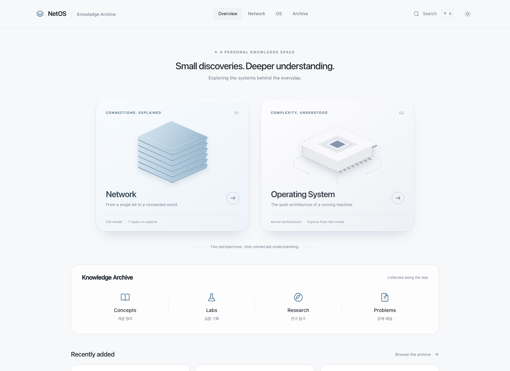
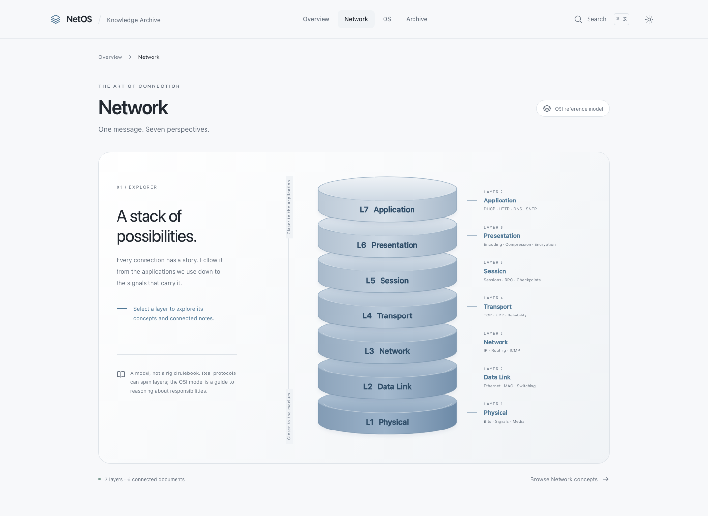
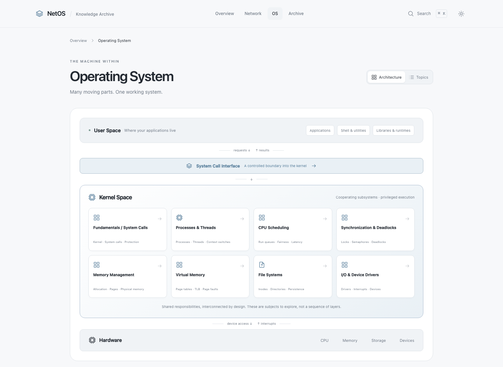

# NetOS

**Network × Operating System — 시각화로 연결하는 시스템 지식**

운영체제와 네트워크의 개념을 지도처럼 탐색하고, 학습·실험·탐구·문제 풀이를 Markdown으로 쌓아가는 개인 지식 아카이브입니다.

[사이트 미리보기](#사이트-미리보기) · [로컬 실행](#로컬-실행) · [글 작성 가이드](docs/templates/작성양식/README.md) · [개발 문서](docs/README.md)

> **[GitHub Pages에서 사이트 보기](https://rhalswjd.github.io/NetOS/)** · 아래 미리보기는 로컬 프로덕션 빌드를 직접 캡처한 화면입니다.

## 사이트 미리보기



<details>
<summary>Network / OS 탐색 화면 보기</summary>

| Network                                                                | Operating System                                                            |
| ---------------------------------------------------------------------- | --------------------------------------------------------------------------- |
|  |  |

</details>

## 주요 기능

### Network

- Sierra Blue 원통형 **OSI 7계층** 시각화
- 계층별 역할·프로토콜·연결된 개념을 탐색하는 허브
- 키보드와 터치로 이동할 수 있는 실제 문서 링크

### Operating System

- **Kernel Architecture Map**으로 보는 운영체제 구성
- 프로세스·스케줄링·동기화·메모리·파일 시스템·I/O 등 하위 영역 탐색
- 아키텍처 지도와 목록형 **Topics** 보기 전환

### Knowledge Archive

- **Concepts · Labs · Research · Problems** 네 종류의 문서
- 주제·분류·태그·난이도 필터와 검색·정렬
- `topicId` / `relatedTopicIds`를 통한 **양방향 관련 콘텐츠 자동 연결**
- Pagefind 본문 검색, Mermaid, 코드 복사, 문제 정답 접기
- 다크 모드, 모바일, 키보드 탐색, reduced-motion 지원

## 주요 기술

| 기술                          | 역할                             |
| ----------------------------- | -------------------------------- |
| Astro                         | 정적 페이지와 파일 기반 라우팅   |
| Starlight                     | 문서 레이아웃·목차·탐색          |
| TypeScript · Zod              | 타입 및 콘텐츠 메타데이터 검증   |
| Markdown / MDX                | 문서 작성과 이미지·첨부파일 연결 |
| Pagefind · Mermaid            | 정적 본문 검색과 다이어그램      |
| Playwright · Node test runner | 브라우저·단위·통합 검증          |
| GitHub Actions · Pages        | 검사 후 정적 사이트 배포         |

## 로컬 실행

**Node.js 24 LTS**와 npm을 사용합니다. 버전 기준은 [`.nvmrc`](.nvmrc)에 있습니다.

```sh
npm ci
npm run dev
```

터미널에 표시되는 Local 주소를 브라우저에서 엽니다.

본문 검색 인덱스는 프로덕션 빌드에서 생성됩니다. 검색까지 확인하려면 다음과 같이 실행합니다.

```sh
npm run build
npm run preview
```

## 문서 작성

1. **[작성 가이드와 기본 양식](docs/templates/작성양식/README.md)**에서 필요한 양식을 복사합니다.
2. 아래 위치에 새 `.md` 또는 `.mdx` 파일을 만들고 제목·본문·메타데이터를 작성합니다.
3. `topicId` 또는 `relatedTopicIds`를 지정하고 `npm run validate`로 검사합니다.
4. 공개할 준비가 되면 `draft: false`로 변경합니다.

| 문서 종류 | 저장 위치                                                             |
| --------- | --------------------------------------------------------------------- |
| Concepts  | `src/content/docs/network/topics/` 또는 `src/content/docs/os/topics/` |
| Labs      | `src/content/docs/labs/`                                              |
| Research  | `src/content/docs/research/`                                          |
| Problems  | `src/content/docs/problems/`                                          |

새 문서를 추가하면 아카이브·탐색 허브·관련 콘텐츠가 함께 갱신됩니다. 화면 코드나 관련 글 목록을 수동으로 수정할 필요가 없습니다.

- 초안은 프로덕션 페이지·목록·검색에서 제외되며 메타데이터·참조 검사는 통과해야 합니다.
- 공개 글이 참조하는 개념도 공개 상태여야 합니다.
- 이미지·PCAP, 문제 출처와 정답 접기는 작성 가이드의 검증된 예시를 사용합니다.
- 기존 샘플 글 9개를 포함합니다. DHCP 실험은 미수행 상태로 표시되어 있습니다.

## 폴더 구조

```text
NetOS/
├── .github/workflows/     # GitHub Pages 검사·배포
├── docs/
│   ├── README.md          # 문서 찾아보기
│   ├── DEVELOPMENT.md     # 구조·라우팅·배포 설정
│   ├── TESTING.md         # 테스트·화면 캡처 안내
│   ├── QA.md              # 실제 검증 기록
│   ├── templates/        # 기본 작성양식과 이전 양식 보관
│   └── assets/           # 사이트 미리보기·디자인 참고 이미지
├── public/               # favicon·실제 문서 첨부파일
├── scripts/              # 콘텐츠·출력 검증과 Markdown 처리
├── src/
│   ├── components/       # 공통 UI와 문서 구성
│   ├── config/           # 연락처 설정
│   ├── content/docs/     # 게시할 Markdown / MDX
│   ├── lib/              # 스키마·분류·자동 연결·공개 경로
│   ├── pages/            # Home·Network·OS·Archive
│   └── styles/           # 공통·문서 스타일
├── tests/                # unit·browser·integration·visual
├── AGENTS.md             # 프로젝트 작업 규칙
├── astro.config.mjs      # Astro / Starlight 설정
├── package.json          # 의존성과 실행 명령
├── package-lock.json     # 재현 가능한 의존성 설치
├── playwright.config.ts  # 브라우저 검증 설정
└── tsconfig.json         # TypeScript 설정
```

`.env.example`, `.nvmrc`, `.prettierrc.json`, `.prettierignore` 등 도구가 찾는 설정도 루트에 유지합니다. 로컬 Apple 디자인 스킬은 Git에서 제외합니다.

## 검증

최초 한 번 Chromium을 설치한 뒤 전체 검사를 실행합니다.

```sh
npx playwright install chromium
npm run qa
```

`qa`는 타입 검사 → 단위 테스트 → 프로덕션 빌드 → 내부 링크 검사 → 브라우저 테스트 순서로 실행합니다.

| 명령                     | 목적                                               |
| ------------------------ | -------------------------------------------------- |
| `npm run validate`       | 메타데이터·분류·ID·참조 검증                       |
| `npm run check`          | Astro / TypeScript 타입 검사                       |
| `npm test`               | 단위 테스트                                        |
| `npm run test:e2e`       | 빌드된 사이트의 데스크톱·모바일 브라우저 검사      |
| `npm run test:discovery` | Markdown 자동 발견·교차 연결·MDX Mermaid 빌드 검사 |
| `npm run test:templates` | 양식·정답 접기·검색 제외·첨부파일·초안 검사        |

통합 테스트는 임시 문서와 빌드 결과를 생성한 뒤 정리·복원합니다. 다른 빌드와 동시에 실행하지 마세요. 자세한 실행법과 미리보기 이미지 갱신법은 [테스트 안내](docs/TESTING.md)에 있습니다.

## GitHub Pages 배포

사이트는 [GitHub Pages](https://rhalswjd.github.io/NetOS/)에서 운영합니다.

1. 프로젝트를 GitHub 저장소에 올립니다. 배포 기준 브랜치는 `main`입니다.
2. 저장소 **Settings → Pages → Build and deployment → Source**를 **GitHub Actions**로 선택합니다.
3. `main`에 변경을 반영하거나 Actions에서 **Validate and deploy to GitHub Pages**를 수동 실행합니다.

[배포 워크플로](.github/workflows/deploy.yml)는 검사가 모두 성공한 경우에 배포합니다. 이후 Markdown 변경도 같은 흐름으로 반영됩니다. 로컬 작업 폴더를 GitHub 변경과 맞추려면 `git pull`이 필요합니다.

저장소 하위 경로·사용자 사이트·커스텀 도메인 설정은 [개발 가이드](docs/DEVELOPMENT.md#배포-설정)를 참고하세요.

## 문서와 연락처

[문서 모음](docs/README.md) · [작성 양식](docs/templates/README.md) · [테스트 안내](docs/TESTING.md) · [검증 기록](docs/QA.md)

푸터의 GitHub·Email은 [`src/config/contact.ts`](src/config/contact.ts)에서만 관리합니다. Email에는 공개를 허용한 SimpleLogin 별칭만 사용하며, 실제 전달 대상 메일함 주소는 코드·문서·환경변수에 기록하지 않습니다. 빈 값은 링크 없는 라벨로 표시됩니다.

### 연락처 개인정보 관리

- 공개 별칭도 스팸을 받을 수 있습니다. SimpleLogin 대시보드에서 해당 별칭의 **Contacts**를 열어 특정 발신자를 차단하거나, 별칭 토글을 꺼서 전체 수신을 중단합니다. [공식 관리 안내](https://simplelogin.io/docs/getting-started/block-sender/)
- 전달받은 메일에는 **답장**을 사용하고 수신자가 SimpleLogin 역별칭인지 확인합니다. 상대방의 원래 주소로 직접 새 메일을 보내면 실제 메일함 주소가 노출될 수 있습니다. [역별칭 안내](https://simplelogin.io/docs/getting-started/reverse-alias/)
- 별도 테스트 계정으로 별칭에 메일을 보낸 뒤 답장받아, 수신된 원문의 `From`, `Reply-To`, 전체 헤더·서명·인용문에 실제 주소나 본명이 없는지 확인합니다. Gmail의 발신자 표시 이름과 자동 서명도 점검합니다. 실제 송수신과 계정 설정은 사이트 테스트만으로 확인할 수 없습니다.
- 커밋 이메일은 NetOS 저장소의 로컬 Git 설정에서 GitHub가 제공한 noreply 주소를 사용합니다. GitHub의 **Settings → Emails**에서 비공개 이메일 및 개인 이메일이 포함된 push 차단 설정을 직접 확인하세요. 계정 설정은 다른 저장소에도 영향을 줍니다.
- Git 설정을 바꿔도 과거 커밋의 이메일은 바뀌지 않습니다. 이력 정리는 별도 승인 후 백업과 협업자 조율을 거쳐 진행해야 하며, 이미 복제된 저장소와 캐시의 완전 삭제는 보장할 수 없습니다.
