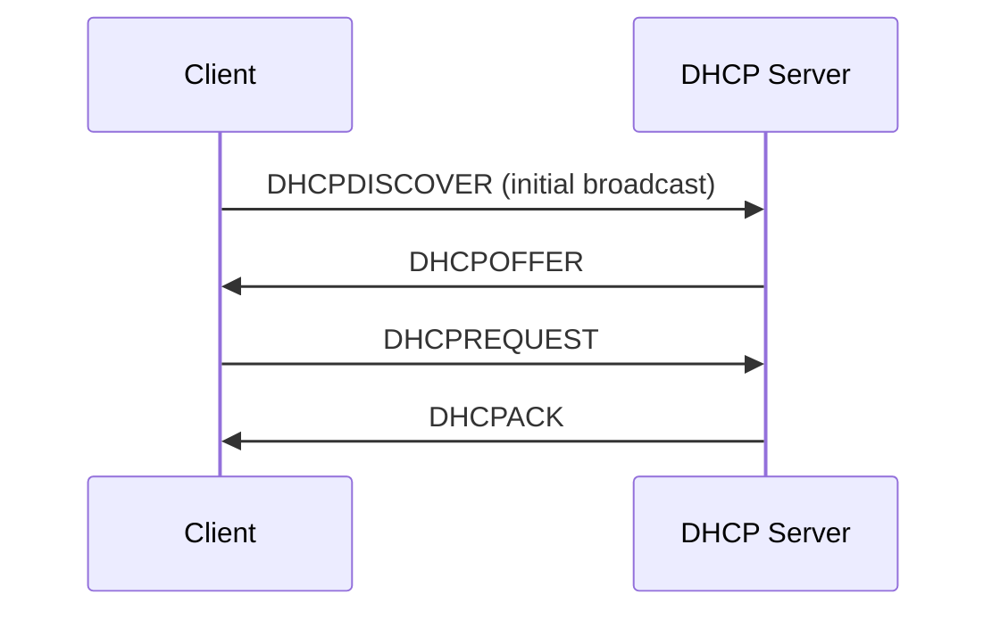

## 개요

DHCP는 네트워크에 연결된 호스트가 IP 주소와
기타 네트워크 설정을 자동으로 얻도록 돕는 프로토콜이다.

## 왜 필요한가?

관리자가 모든 호스트의 IP 주소를 수동으로 설정하면
관리 비용이 증가하고 설정 충돌이 발생하기 쉽다.

## 핵심 원리

초기 주소 획득 과정은 일반적으로 DORA로 설명한다.

1. Discover
2. Offer
3. Request
4. Acknowledgment

## 동작 과정

DHCP는 UDP를 사용한다.

서버는 일반적으로 UDP 67번 포트,
클라이언트는 UDP 68번 포트를 사용한다.

초기 Discover는 서버를 모르는 상태에서
브로드캐스트를 이용하여 서버를 탐색할 수 있다.

단, 모든 DHCP 메시지가 언제나 브로드캐스트인 것은 아니다.

## 헷갈리기 쉬운 개념

초기 주소 획득 과정과 기존 임대 주소를 갱신하는
과정의 패킷 전송 방식을 구분해야 한다.

## 관련 개념

UDP, IP Broadcast, DHCP Relay

## 예제 또는 시각화

아래 흐름은 일반적인 초기 임대 획득을 설명한다. 재전송, Relay, 임대 갱신은 생략한 개념도다.

## 더 읽기

- [RFC 2131 — Dynamic Host Configuration Protocol](https://www.rfc-editor.org/rfc/rfc2131.html)

관련 문서는 본문 아래에서 메타데이터를 기준으로 자동 연결된다.
