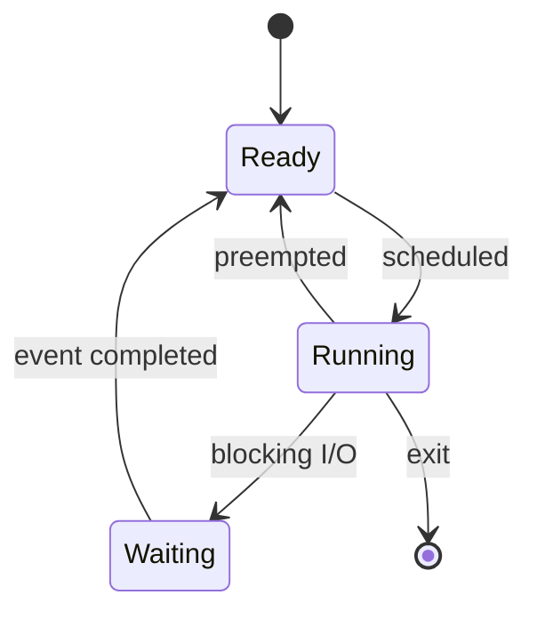

## 개요

프로세스는 실행 중인 프로그램을 운영체제가 관리하는 단위다. 코드뿐 아니라 가상 주소 공간, 열린 파일, 보안 자격, 실행 상태 등도 포함한다. 프로그램 파일과 그 프로그램을 실행하는 프로세스는 서로 다른 개념이다.

## 왜 필요한가?

여러 프로그램은 같은 컴퓨터의 CPU와 메모리를 공유한다. 프로세스마다 주소 공간과 접근 권한을 구분하면 한 프로그램의 오류가 다른 프로그램의 메모리를 임의로 수정하는 일을 제한할 수 있다. 격리는 완벽한 보안의 보장이 아니라 운영체제가 제공하는 중요한 경계다.

## 핵심 원리

**PCB(Process Control Block)**는 교과서에서 프로세스 관리 정보를 모아 설명하는 개념적 자료구조다. 구현마다 이름과 구성이 다르다. 일반적으로 식별자, 상태, 스케줄링 정보, 메모리 관리 정보, 파일 참조 등을 추적한다.

스레드는 프로세스 내부의 실행 흐름이다. 같은 프로세스의 스레드들은 일반적으로 주소 공간과 열린 파일을 공유하지만 각자의 레지스터 상태와 스택을 가진다.

| 항목        | 프로세스             | 같은 프로세스의 스레드   |
| ----------- | -------------------- | ------------------------ |
| 주소 공간   | 일반적으로 분리      | 공유                     |
| 실행 문맥   | 포함                 | 각자 보유                |
| 데이터 교환 | IPC 또는 공유 메모리 | 공유 주소 공간 접근      |
| 동기화      | 자원 공유 시 필요    | 공유 데이터 접근 시 필요 |

## 동작 과정

스케줄러는 실행 가능한 태스크 중 하나를 선택한다. **문맥 교환(context switch)**에서는 현재 태스크의 CPU 상태를 저장하고 다음 태스크의 상태를 복원한다. 다른 주소 공간으로 전환할 때는 관련 메모리 관리 상태도 바뀔 수 있다. 같은 프로세스의 스레드 사이 전환에도 문맥 교환은 존재한다.



## 예제 또는 시각화

다음 명령은 Unix 계열 시스템에서 프로세스 ID와 부모 관계를 살펴보는 예시다. 출력 결과는 실행 환경에 따라 달라진다.

```sh
ps -eo pid,ppid,stat,comm
```

## 헷갈리기 쉬운 개념

시스템 호출로 커널 모드에 진입하는 것과 다른 태스크로 문맥 교환하는 것은 같지 않다. 시스템 호출은 호출한 태스크의 실행 문맥에서 계속 처리될 수 있다. 동시성 역시 여러 CPU에서 실제로 동시에 실행되는 병렬성과 구분한다.

## 관련 개념

가상 메모리는 각 프로세스가 사용하는 주소 공간을 이해하는 다음 단계다. 연결된 개념은 아래에서 자동으로 표시한다.

## 더 읽기

- [Linux kernel: scheduler design](https://docs.kernel.org/scheduler/sched-design-CFS.html)
- [Linux kernel: memory management concepts](https://docs.kernel.org/admin-guide/mm/concepts.html)
